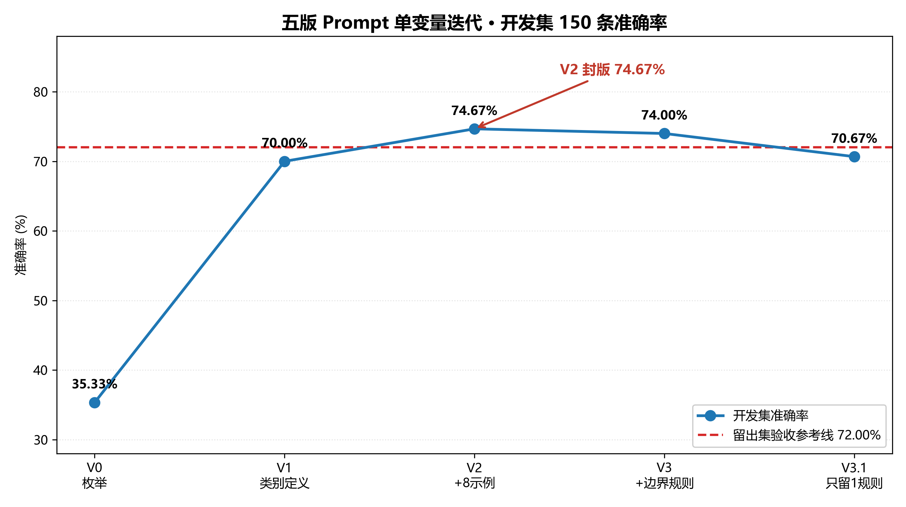
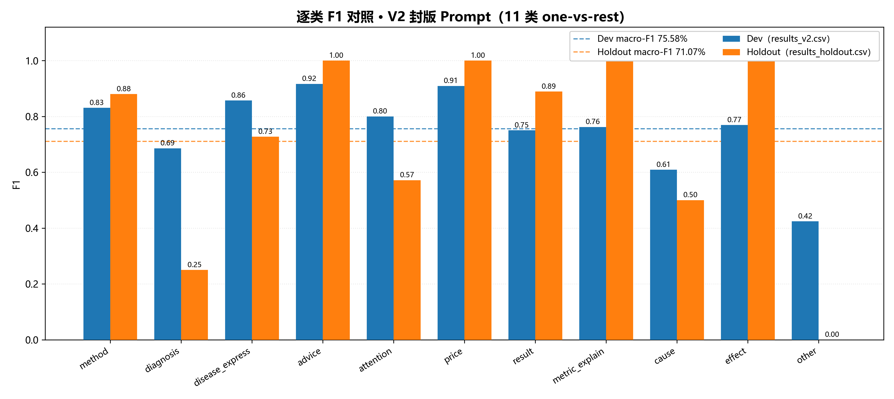

# KUAKE-QIC 医疗搜索意图分类 · Prompt 调优实验
从零搭建 LLM 评测流水线，4 轮单变量迭代将 11 类医疗 query 意图分类准确率从 35.33% 提升至 74.67%，并在调优全程封存的留出集上以 72.00% 通过验收（|差| ≤5pct 线）。
## 结果
| 集合 | 规模 | 准确率 | macro-F1 |
|---|---|---|---|
| 开发集 | 150 | 74.67% | 75.58% |
| 黄金留出集（初见杀） | 50 | 72.00% | 71.07% |

## 五版演进
V0 枚举 35.33% → V1 类别定义 70.00% → V2 加8示例 **74.67%（封版）** → V3 加边界规则 74.00% → V3.1 只留1规则 70.67%
## 核心发现
1. 干预收益递减：类别定义 +34.7pct ＞ few-shot +4.7pct ＞ 边界规则 ±0
2. 规则会互相支撑：V3.1 删掉一条"有害"规则后反而 -3.33pct——Prompt 是系统而非规则清单
3. 金标噪声可测量：Dev 逐行审计 10–13%、考前预注册 12%、成绩震荡带三重证据互证，合理上限 85–90%；按预注册清单归因后留出集净准确率 88%
4. 泛化 = 指纹复现：Dev 与 Holdout 逐类 F1 强弱分布一致（other/diagnosis 双弱，advice/metric/price 双满分）

## 复现
pip install -r requirements.txt
export ZHIPU_API_KEY=<你的Key>
python src/eval_batch.py --data data/holdout.csv
五版 Prompt 见 prompts/，逐轮结果见 results/，完整归因叙事见 reports/REPORT.md。
## 数据来源
见 DATA_SOURCE.md。代码 MIT，数据版权归 CBLUE 原方，仅限研究用途。
